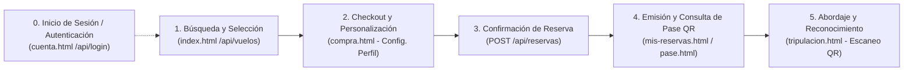

# Métricas de Producto y Verificación: Sesión 25
**Proyecto:** Avianca — PowerCoders 4.0  
**Taller:** Verificar y Medir (Métricas de Producto y Verificación)  
**Foco Metodológico:** Embudo de Conversión — Pregunta 3: *¿La completan?*  

---

## 1. Ruta del Esqueleto Caminante (Walking Skeleton)

El esqueleto caminante conecta de punta a punta la entrega de valor de la hipótesis de diseño de Avianca Clase Ejecutiva (caso Ing. Ceballos: reserva personalizada y reconocimiento prioritario a bordo). Comprende cinco eventos críticos secuenciales:



> **Nota sobre la Autenticación del Cliente:**  
> En una aerolínea real y en nuestra plataforma existen dos caminos válidos para la sesión:
> - **Acceso previo:** El usuario ingresa primero a `cuenta.html`, inicia sesión con sus credenciales de cliente y procede a la búsqueda.
> - **Acceso en checkout:** El usuario busca vuelos públicamente en `index.html` y, al entrar a `compra.html` para reservar, el sistema verifica la sesión (`GET /api/sesion`); si no está autenticado, le solicita iniciar sesión obligatoriamente antes de confirmar.
> En ambos casos, **la autenticación activa con rol `cliente` es un prerrequisito indispensable**: `POST /api/reservas` rechaza con `HTTP 401 Unauthorized` a cualquier visitante anónimo.

1. **Búsqueda y Selección de Vuelo (`index.html`):** El cliente consulta vuelos reales mediante `GET /api/vuelos`, filtra por origen, destino, fecha y cabina ejecutiva, y selecciona una opción del catálogo.
2. **Inicio del Checkout y Configuración de Preferencias (`compra.html`):** El cliente autenticado carga sus datos de pasajero y personaliza su perfil de viaje: trato formal (*"Ing. Ceballos"*), motivo corporativo, menú vegetariano, alergias, solicitud de enchufe y preferencia de descanso (`noMolestar: true`).
3. **Confirmación de Reserva y Persistencia Transaccional (`POST /api/reservas`):** El backend valida el vuelo, disponibilidad de cabina y asientos ejecutivos (filas 4 a 11 o 2A). Persiste de forma coordinada en las colecciones `reservas`, `boletos`, `pasajeros` y `perfiles_viaje`, emitiendo un boleto con payload seguro firmado en `textoQR` (HTTP 201).
4. **Emisión y Consulta de Pase Digital (`mis-reservas.html` y `pase.html`):** El cliente consulta sus boletos activos y visualiza su pase de abordar digital con el código QR canónico generado según el estándar de abordaje.
5. **Abordaje y Entrega de Valor a Bordo (`tripulacion.html` / `POST /api/tripulacion/vuelos/:id/abordajes`):** La azafata escanea el código QR del pase con la cámara o carga la imagen. El backend valida contra la base de clientes, registra el evento en `abordajes` (base Avianca) y despliega instantáneamente en el panel la ficha personalizada de la Ing. Ceballos. Aquí se concreta el valor real del producto.

---

## 2. Definición de la Métrica de Producto

### Nombre de la métrica
**Tasa de Completitud del Esqueleto Caminante (*Walking Skeleton Funnel Completion Rate*)**

### Fórmula estricta (expresada como tasa)
$$\text{Tasa de Completitud} = \left( \frac{\text{Reservas confirmadas y boletos emitidos con éxito (\textit{completados})}}{\text{Intentos de confirmación de reserva iniciados (\textit{iniciados})}} \right) \times 100$$

Complementariamente, para el ciclo de valor final de abordaje a bordo:
$$\text{Tasa de Abordaje Efectivo} = \left( \frac{\text{Pasajeros abordados y reconocidos con ficha (\textit{abordados})}}{\text{Reservas confirmadas y boletos emitidos (\textit{completados})}} \right) \times 100$$

### Justificación metodológica
* **Por qué responde a la Pregunta 3 ("¿La completan?"):**  
  Las preguntas 1 ("¿Lo ven?") y 2 ("¿Lo prueban?") solo miden tráfico o clics superficiales. La Pregunta 3 evalúa si los usuarios que decidieron contratar el servicio lograron atravesar todas las capas del sistema (interfaz, validadores, autenticación RBAC, transacciones y persistencia en MongoDB) hasta recibir su confirmación y boleto QR.
* **Por qué tiene denominador y no es una métrica de vanidad (Output vs. Outcome):**  
  - *Métrica de vanidad (Output):* "Tenemos 1,500 visitas acumuladas" o "Se han registrado 200 usuarios". Estas cifras siempre crecen monotónicamente, ocultan problemas y no informan decisiones.
  - *Métrica de resultado (Outcome):* Evalúa la efectividad del sistema relacionando el éxito con el universo de intentos. Registrar 40 reservas cuando hubo 45 intentos representa un saludable **88.89%**; registrar esas mismas 40 reservas cuando hubo 400 intentos revela una tasa crítica del **10.00%**, evidenciando un cuello de botella técnico severo.
* **Por qué puede bajar:**  
  La tasa no es acumulativa; se calcula sobre ventanas operativas o conteo de flujo activo. Desciende de forma inmediata si surgen errores HTTP 400 por validación estricta, errores 401 por expiración de tokens, colisiones `E11000` de concurrencia en índices únicos de asientos/pasajeros, o bloqueos por timeout en MongoDB Atlas.

---

## 3. Mecanismo de Medición Técnica

Bajo la directriz de cátedra **"cuatro contadores y una consulta bastan"**, se implementó una instrumentación desacoplada y libre de librerías pesadas en [backend/metricas.js](backend/metricas.js):

### Los cuatro contadores atómicos
En la colección `metricas_embudo` de MongoDB (documento `_id: 'embudo_esqueleto'`), el backend actualiza de forma atómica:
1. `iniciados`: Se incrementa al recibir la solicitud en `POST /api/reservas`.
2. `validados`: Se incrementa tras verificar autenticación del cliente y conformidad del esquema del vuelo y pasajeros.
3. `completados`: Se incrementa cuando la transacción finaliza con éxito, emitiendo boletos, reservas y `perfiles_viaje` (HTTP 201).
4. `abordados`: Se incrementa cuando la tripulación escanea y valida el código QR en `POST /api/tripulacion/vuelos/:id/abordajes`.

### La consulta ligera
Un endpoint interno `GET /api/metricas/embudo` ejecuta una única lectura y devuelve la tasa en tiempo real:

```json
{
  "ok": true,
  "metrica": "Tasa de Completitud del Esqueleto Caminante",
  "preguntaEmbudo": "¿La completan? (Pregunta 3)",
  "formula": "(completados / iniciados) * 100",
  "contadores": {
    "paso1_iniciados": 50,
    "paso2_validados": 48,
    "paso3_completados": 45,
    "paso4_abordados": 35
  },
  "tasaCompletitud": 90.00,
  "unidad": "%",
  "tasaAbordaje": 77.78,
  "decisionAsociada": "Si la tasa cae por debajo del 80%, se prioriza la HU técnica de resiliencia concurrente y optimización de índices en MongoDB Atlas.",
  "actualizadoEn": "2026-10-27T15:35:00.000Z"
}
```

---

## 4. Decisión Técnica Asociada (Acción ante Caídas)

### Diagnóstico ante una caída abrupta (Ejemplo: de 90% a 45%)
Si la tasa de completitud cae a la mitad en la siguiente semana, el equipo evalúa inmediatamente la siguiente **hipótesis técnica**:
> *"La degradación en la tasa de completitud se debe a contención y colisiones de clave única (`E11000 duplicate key error` en el índice `asiento_ocupado_una_vez` o `documento_pasajero_unico`) ante reservas concurrentes de asientos populares, o a agotamiento del pool de conexiones serverless hacia MongoDB Atlas."*

### Historia concreta que entra al Backlog del siguiente Sprint
* **Código / Título:** `[HU-TECH-26] Optimización de concurrencia y reintentos automáticos en inventario de asientos`
* **Descripción:**  
  *Como* arquitecto del sistema de reservas,  
  *quiero* implementar un mecanismo de reserva con reintento automático no bloqueante y auto-asignación de asiento alternativo en caso de colisión de índice,  
  *para que* la Tasa de Completitud del Esqueleto Caminante se restablezca por encima del **85%** sin generar rechazos HTTP 503/400 al usuario final.
* **Criterios de Aceptación:**
  1. Ante una colisión de asiento ocupado en MongoDB, el backend reasigna automáticamente el siguiente asiento contiguo disponible de la misma cabina sin abortar la transacción.
  2. La tasa de completitud en `GET /api/metricas/embudo` debe mantenerse $\ge 85\%$ bajo pruebas de carga de 30 solicitudes simultáneas.
  3. El tiempo de respuesta de `POST /api/reservas` no debe exceder los 800 ms en el percentil 95 (P95).

---

## 5. Defensa para la Demostración (Pitch de 30 Segundos)

> *"En Avianca PowerCoders rechazamos los contadores de visitas y registros porque son métricas de vanidad que siempre suben y enmascaran las fallas del sistema. Nosotros instrumentamos la Pregunta 3 del embudo: **'¿La completan?'**, midiendo la Tasa de Completitud del esqueleto caminante: cuántos intentos de compra terminan efectivamente con reserva y pase QR emitido en MongoDB Atlas.  
> Aplicando la regla de cátedra, con **cuatro contadores atómicos y una sola consulta ligera**, monitoreamos el embudo de punta a punta. Si la tasa cae del 90% al 45%, no especulamos: sabemos exactamente si el fallo ocurrió en validación o en persistencia, y disparamos una historia técnica priorizada al backlog para blindar la concurrencia y recuperar el valor del producto."*
